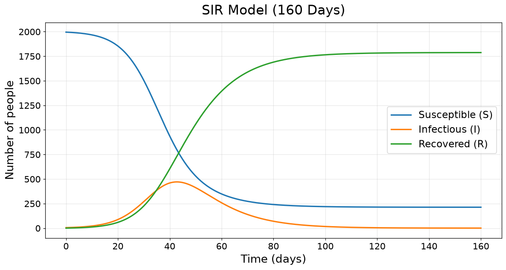
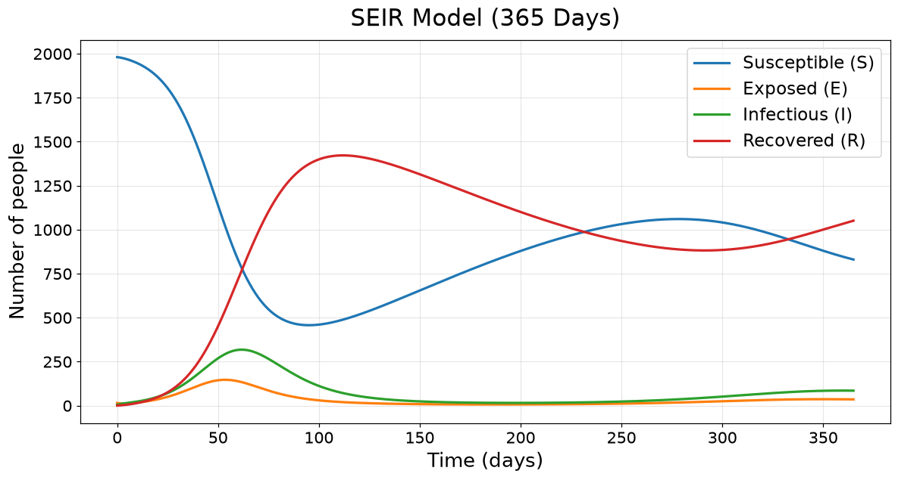
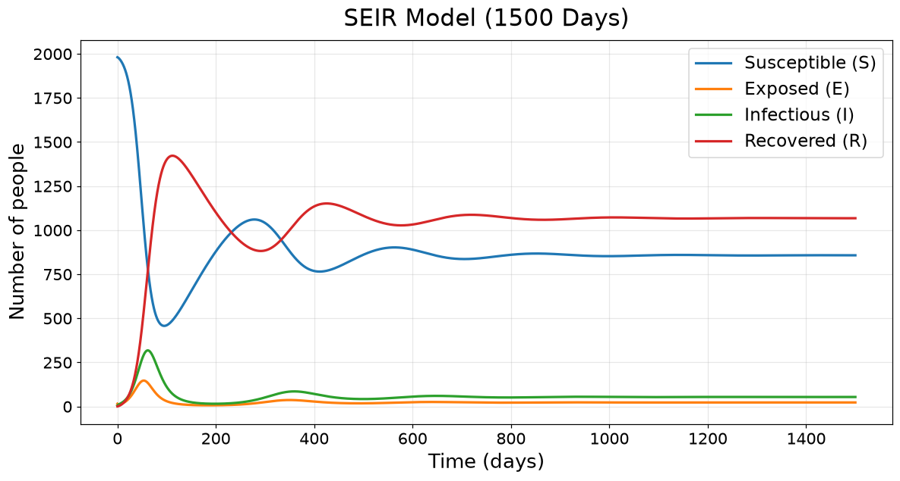
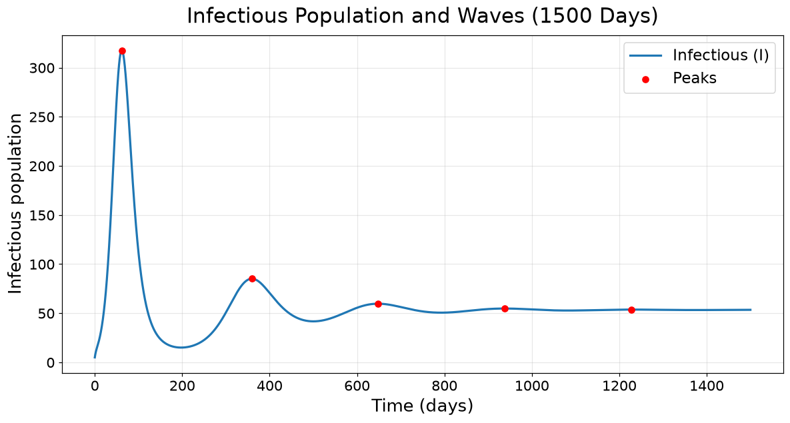
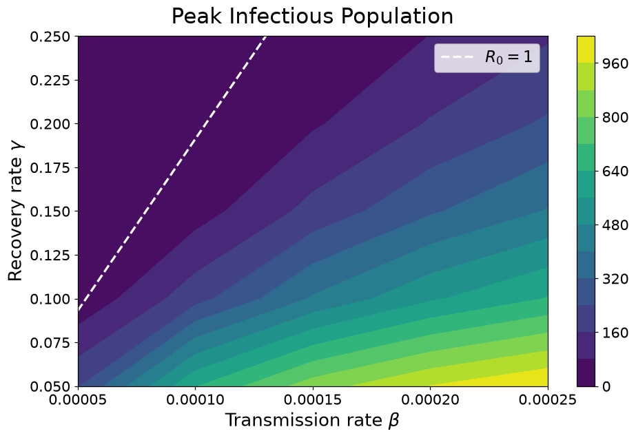
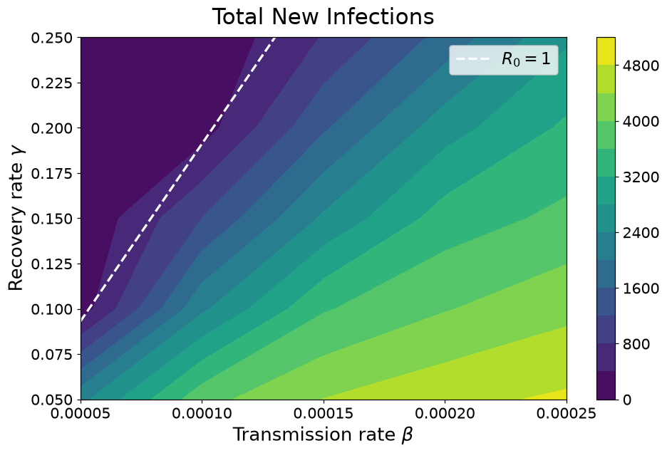

# BMI 500 - Homework 7

**Name:** Elara Liu

**Email:** elara.liu@emory.edu

**Question:** HW 1

## A–C. SIR model

The infectious population peaks on day 42.7, with 470.46 infectious people. At the peak, about 800 people remain susceptible, when new infections and recoveries are nearly equal.

The basic reproduction number is R₀ = 2.5. It is above 1, so infections initially grow. As the susceptible population decreases, infections eventually fall.

By day 160, about 213 people have never been infected. The model ends with S = 212.79, I = 0.20, and R = 1787.01. S decreases, I rises and then falls, and R keeps increasing.



## D. SEIR with births and deaths

The model has five infection peaks over 1500 days:

| Wave | Day | Peak infectious |
| --- | ---: | ---: |
| 1 | 61.7 | 317.60 |
| 2 | 359.4 | 85.09 |
| 3 | 648.0 | 59.66 |
| 4 | 937.8 | 54.76 |
| 5 | 1227.9 | 53.68 |

The later peaks get smaller, and the infectious population settles near 53 people. The SEIR reproduction number is R₀ ≈ 2.334, compared with 2.5 for SIR. The expected long-term susceptible population is N/R₀ = 856.80, close to the simulated 856.92 on day 1500.

The exposed group delays infectiousness. The birth/death rate is also very high: μ = 0.005/day gives a mean lifespan of 200 days. Births quickly replenish susceptible people and allow later waves. With a more realistic lifespan, replenishment would be slower and later waves would likely be less visible within 1500 days.

**365 days:**



**1500 days:**



**Infection waves:**



## E. Sensitivity analysis

I ran 25 parameter combinations for 365 days. I varied β from 0.00005 to 0.00025 and γ from 0.05 to 0.25. Total new infections were calculated by summing βSI × Δt at each time step, since births and deaths also change S.

Larger β generally produces higher peaks and more new infections. Larger γ reduces both. The dashed line in each plot marks R₀ = 1, with

γ = βNσ / (σ + μ) − μ.

**Peak infectious population:**



**Total new infections:**



Holding the other parameter at its midpoint, the infection peak changes by about 394 people across the β range and 822 people across the γ range. For total new infections, the changes are about 3,669 and 3,580, respectively.

Social distancing can reduce β. Treatments that shorten the infectious period can increase γ. Both can help limit transmission.

## Discussion

My hypothesis was partly supported. For SIR, I predicted a peak near day 50 with about 536 infectious people, but the simulation gave day 42.7 and 470.46. I used much larger Euler steps for the initial estimate. The SEIR model showed multiple waves with decreasing peaks, as I predicted. I also expected β to have a slightly larger effect on the infection peak, but γ had a larger effect in the parameter comparison above.

## AI Statement

No generative AI (in any form) has been used to complete this homework.

## How to run

Either works. Use only one of the following methods.

### UV

Install [uv](https://docs.astral.sh/uv/) (if haven't yet), then run:

```bash
uv sync
uv run jupyter notebook HW1_SIR_SEIR.ipynb
```

### pip

Run the following commands in a terminal:

```bash
python3 -m venv venv
source venv/bin/activate
pip install -r requirements.txt
jupyter notebook HW1_SIR_SEIR.ipynb
```
